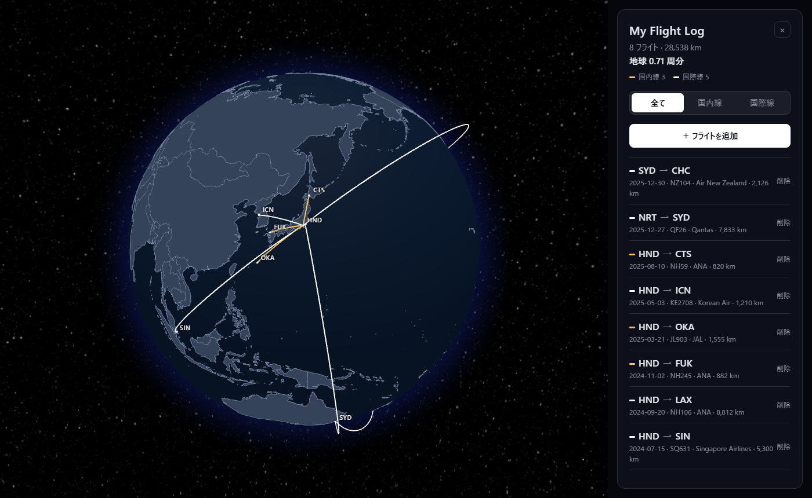

# My Flight Log

乗ったフライトを記録して、地球儀の上に路線を描く個人用のフライトログアプリです。

**公開版:** https://timmy-0123bot.github.io/my-flight-log/



## 主な機能

- **地球儀で路線を表示**: 暗い色の地球儀に、記録したフライトを弧線で描きます。国内線はアンバー、国際線は白です。
- **空港検索**: 3レターコード（`HND`）か、英語の都市名・空港名（`Christchurch`）で探せます。収録は定期便が飛ぶ世界の約4,000空港です。
- **かんたん入力**: 必須は出発と到着の空港だけで、日付・便名・航空会社は空欄でも登録できます。1便追加すると到着地が次の出発地に入るので、乗り継ぎを続けて入力できます。
- **集計**: 総フライト数、総飛行距離（大圏距離）、地球何周分か、国内線・国際線それぞれの便数を表示します。
- **絞り込み**:
  - 「全て / 国内線 / 国際線」のボタンで、地図と一覧に出す路線を切り替えます。
  - 地図上の空港コードを押すと、その空港を発着する路線だけになります。もう一度押すか、地図の何もないところを押すと元に戻ります。
- **バックアップ**: 全フライトを JSON ファイルに書き出し、読み込んで復元できます。

## データの保存について

フライトの記録はサーバーには送らず、**使っているブラウザの中（localStorage）にだけ**保存しています。

- 別のブラウザや別の端末では、記録は共有されません。
- ブラウザのサイトデータを消すと、記録も消えます。ときどき「書き出し」でバックアップしてください。
- 端末を移るときは、元の端末で「書き出し」したファイルを、新しい端末で「読み込み」します。なお、読み込むと今の記録はファイルの内容に置き換わります。

## 開発

Node.js 24 以降が必要です。

```bash
npm install
npm run dev        # 開発サーバー（http://localhost:5173/）
npm run build      # 型チェック + 本番ビルド（dist/）
npm run preview    # 本番ビルドの確認（http://localhost:4173/my-flight-log/）
```

### 空港データの更新

空港データ（[src/data/airports.json](src/data/airports.json)）は、OurAirports の公開データから作っています。最新の内容に更新するときは次を実行します。

```bash
npm run build:airports
```

IATA コードがあり、定期便が飛んでいる空港だけを取り出します（[scripts/build-airports.mjs](scripts/build-airports.mjs)）。

### 公開（GitHub Pages）

`main` ブランチにプッシュすると、GitHub Actions（[.github/workflows/deploy.yml](.github/workflows/deploy.yml)）が自動でビルドし、GitHub Pages に公開します。

公開版は `/my-flight-log/` の下で配信されるため、[vite.config.ts](vite.config.ts) では、ビルドとプレビューのときだけ `base` を `/my-flight-log/` にしています。`public/` 内のファイルを参照するときは、`/xxx.png` のような絶対パスにせず、`import.meta.env.BASE_URL` を前に付けてください。

## 使用技術

- [React](https://react.dev/) + TypeScript + [Vite](https://vite.dev/)
- [react-globe.gl](https://github.com/vasturiano/react-globe.gl)（[three.js](https://threejs.org/) を使った地球儀の描画）
- [topojson-client](https://github.com/topojson/topojson-client)

## データ・素材の出典

- 空港データ: [OurAirports](https://ourairports.com/data/)（パブリックドメイン）
- 国境データ: [Natural Earth](https://www.naturalearthdata.com/)（パブリックドメイン）。[world-atlas](https://github.com/topojson/world-atlas)（ISC License）の 1:50m 版を利用しています。
- 星空の背景画像: [three-globe](https://github.com/vasturiano/three-globe) のサンプル画像（MIT License）
